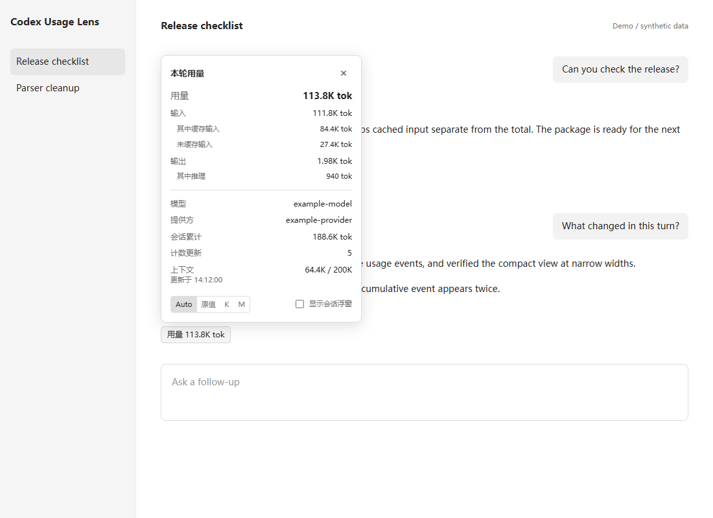

# Codex Usage Lens

**Per-turn token usage, directly beneath your Codex replies.**

An independent, MIT-licensed Codex Desktop plugin. Click a compact usage button
to inspect input, cached input, output, reasoning, and the session total.
An optional draggable meter keeps the current session total visible.

[中文说明](README.zh-CN.md)



## Install From The Plugin Marketplace

In Codex, open **Plugins → Add marketplace**, and enter:

```text
https://github.com/LoveYouEndless/codex-usage-lens
```

Install **Codex Usage Lens**, then ask:

```text
Start Codex Usage Lens.
```

The plugin includes an activation skill, the local runtime, and a marketplace
manifest. It does **not** require an API key or paid service. The runtime has
zero production dependencies and requires Node.js 22 or newer. The Windows
controller can use Codex's cached Node runtime when available.

**One-time desktop setup:** the desktop app needs a loopback debugging port.
If your launcher already provides one, Lens discovers ports 9229, 9222, 9230,
and 9223 automatically. Otherwise, finish active work and close Codex normally,
then ask the activation skill to create a dedicated debug-enabled shortcut.
The Windows launcher can also be run manually:

```powershell
.\scripts\launch-windows.ps1 -CreateShortcut
# After closing Codex normally, open the new desktop shortcut.
.\scripts\control.ps1 -Action Start
```

If automatic executable discovery fails, pass `-CodexPath "C:\path\to\Codex.exe"`.
For a custom port, use the same `-Port` on the launcher and controller.
The shortcut targets the installed executable: recreate it if an app update
changes that path. Lens never terminates Codex or modifies its installation.

The helper reconnects after a desktop renderer reload or app restart while it
is running. Start it again after signing out or rebooting; this release does
not install a login service.

## Controls

- Click **Usage** beneath a final reply to open details.
- Click outside the panel or press Escape to dismiss it.
- Select Auto, Raw, K, or M for display units.
- Enable **Show session meter** in the panel for a draggable floating total.
- Ask **Stop Codex Usage Lens** to remove the UI and stop its helper.

The interface uses Chinese for `zh` locales, and English otherwise.

CLI controls from the plugin root:

```sh
node src/cli.mjs start
node src/cli.mjs status
node src/cli.mjs stop
node src/cli.mjs start --port 9229
```

`CODEX_HOME` selects the log home. `--codex-home` and `--state-dir` override log
and helper-state locations. Default state is `%LOCALAPPDATA%\CodexUsageLens` on
Windows and `$CODEX_HOME/usage-lens` (or `~/.codex/usage-lens`) elsewhere.

## What The Numbers Mean

Turn usage sums cumulative counter differences across the user turn, including
tool-related model requests. A usage update count is **not** an exact request
count. Duplicate cumulative records add no usage.

Cached input is included in input; reasoning is included in output. They are
shown as breakdowns and are never added to the total a second time. Context
shows the most recently recorded input occupancy, not all-time spending.
Totals are token records, **not** subscription credits or a billing estimate.

If a resumed log starts with earlier cumulative totals, Lens uses the recorded
last-call usage for the first observable increment and marks the turn
incomplete. Counter decreases start a new local counting epoch; after such a
reset the displayed session total includes both epochs. Missing records cannot
be reconstructed, and incomplete logs may undercount a turn.

Historical rollouts with the same session ID are merged by turn ID. Their
cumulative session totals are not summed together.

## Compatibility And Privacy

- Windows is the first supported setup path. The core runtime is portable, but
  macOS/Linux launcher setup has not been validated.
- The UI currently targets desktop builds exposing response annotation message
  IDs and assistant action timestamps. It does not inject into browser ChatGPT.
- Only local UUID sessions with matching log metadata are supported. Remote
  sessions without local logs show no usage.
- Message IDs bind a final reply to its recorded turn; Lens does not use reply
  text, guessed ordering, or another session's totals as a fallback.
- The helper connects to one main renderer. Multiple windows are not covered
  by the first release.
- This is temporary DOM injection through Chrome DevTools Protocol, not an
  official native footer extension. App DOM/log changes can require an update.
- Runtime operation sends no data to remote servers. Logs are read locally;
  only counters, session/turn/message IDs, model names, and timestamps are
  transferred to the local renderer. Conversation bodies are not retained or
  transferred by Lens. No installed files or session logs are written.
- A debugging port allows local software to control the renderer. Keep it
  bound to loopback; do not expose or forward it to a network.

To uninstall, stop Lens before removing the plugin. Delete its dedicated
shortcut and state directory if desired. Marketplace removal alone does not
stop an already-running helper.

## Development

```sh
npm ci
npm test
npx playwright install chromium
npm run test:ui
npm run demo
```

The demo and published screenshots use synthetic data. Browser tests cover
desktop/mobile widths, light/dark mode, popup bounds, units, session switching,
repeat injection, and cleanup. `PLAYWRIGHT_CHANNEL=chrome` can use an installed
Chrome browser instead of a downloaded Chromium.

The runtime, parser, and UI were written independently for this project.
Codex Monitor was a visual feasibility reference; no code was copied from it.

MIT licensed. See [LICENSE](LICENSE).
